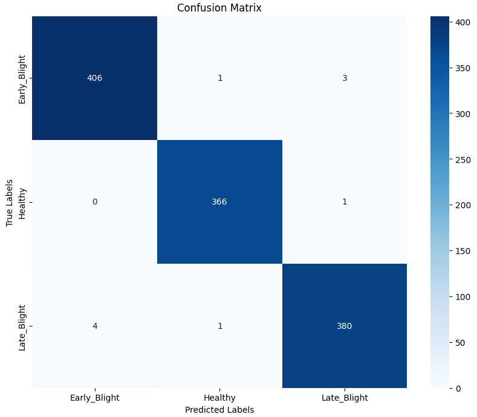
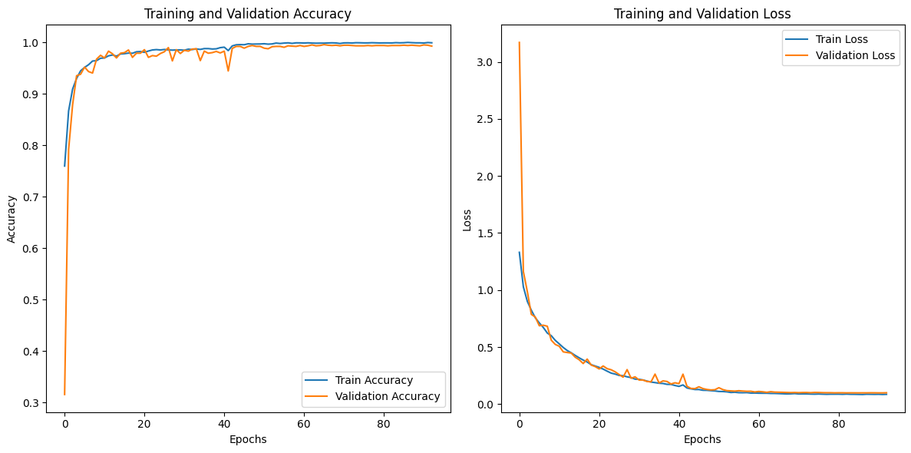
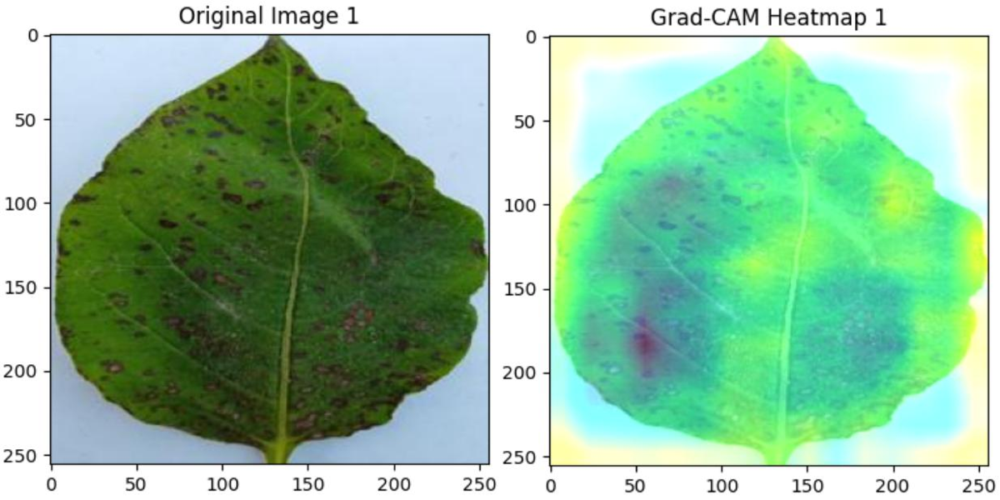
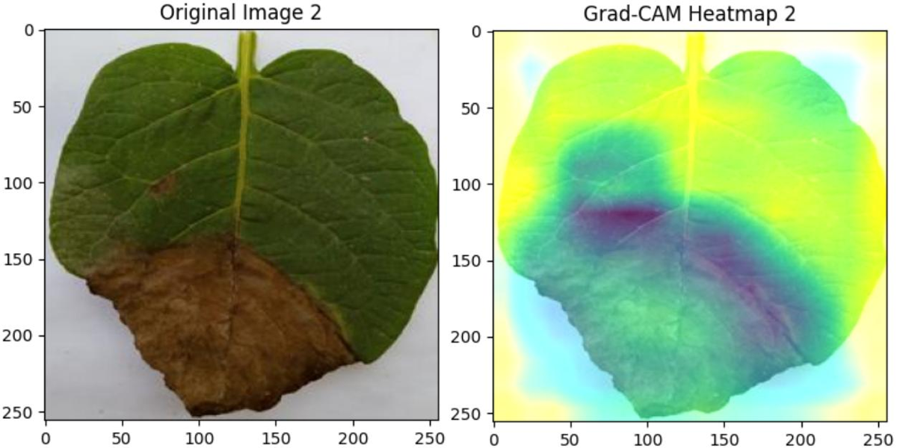
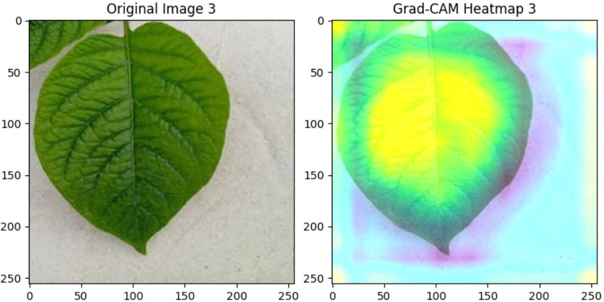

# Potato Leaf Disease Detection using Deep Learning with Explainable AI

A custom lightweight CNN is compared against three transfer-learning models (ResNet152V2, VGG16, InceptionV3) for classifying potato leaves into **Early Blight**, **Late Blight** and **Healthy**, with **Grad-CAM** used to visualise what the model looks at.

## Highlights
- Proposed CNN reaches **99.14 %** test accuracy with only **6.82 M** parameters, outperforming much larger pre-trained models.
- Grad-CAM heatmaps show which leaf regions drive each prediction.
- All models were trained on Kaggle GPUs (T4 / P100).

## Dataset
PlantVillage potato subset, balanced across 3 classes, **11,602 images** in total. Images are converted to RGB, resized to 256x256 and scaled to [0, 1].

| Split | Early Blight | Late Blight | Healthy | Share |
|---|---|---|---|---|
| Train | 3070 | 2877 | 2746 | 75 % |
| Validation | 614 | 575 | 549 | 15 % |
| Test | 410 | 385 | 367 | 10 % |

Augmentation (Keras `ImageDataGenerator`): rotation up to 15 degrees, 10 % width/height shift, shear, 20 % zoom, horizontal flip, plus brightness adjustment.

The dataset is **not** included in this repo. The notebook reads a pre-split, pre-augmented Kaggle dataset (`merged-augmented` with `Train/`, `Valid/`, `Test/` folders, each containing `Early_Blight/`, `Healthy/`, `Late_Blight/`). Place it under `data/merged-augmented`.

## Models
| Model | Details |
|---|---|
| **Proposed CNN** | 6 conv blocks (32→1024 filters, each Conv + LeakyReLU + BatchNorm + MaxPool, L2 regularisation), Dropout 0.3, GlobalAveragePooling, Dense(512), Dropout 0.4, 3-way softmax |
| ResNet152V2 | ImageNet weights, frozen base, Flatten + Dense(256, ReLU) + Dropout(0.2) + softmax |
| VGG16 | ImageNet weights, custom classifier head |
| InceptionV3 | ImageNet weights, custom classifier head |

Training: Adam (lr 1e-4, clipnorm 1.0), categorical cross-entropy, batch size 32, up to 100 epochs with ReduceLROnPlateau and Early Stopping (patience 10).

## Results
| Model | Accuracy (%) | Precision | Recall | F1-score | Parameters | Epochs run |
|---|---|---|---|---|---|---|
| **Proposed CNN** | **99.14** | 0.9900 | 0.9933 | 0.9933 | 6,822,595 | 93 |
| ResNet152V2 | 95.96 | 0.9600 | 0.9566 | 0.9600 | 91,887,107 | 29 |
| InceptionV3 | 92.86 | 0.9300 | 0.9266 | 0.9033 | 40,678,179 | 37 |
| VGG16 | 91.48 | 0.9133 | 0.9133 | 0.9166 | 23,104,323 | 41 |

### Confusion matrix (proposed CNN)


### Training curves (proposed CNN)


Plots for every model are in [`results/`](results/).

## Explainable AI (Grad-CAM)
Grad-CAM is computed on the last convolutional layer and overlaid on the input leaf. Original image on the left, heatmap on the right.

**Early Blight**



**Late Blight**



**Healthy**



Limitations noted in the thesis: heatmaps can be diffuse, and focus is less sharp when symptoms are subtle. Healthy leaves were the hardest class across models.

## Repository structure
```
.
├── notebooks/     # pldd-sequential.ipynb
├── src/           # model.py, train.py, gradcam.py (refactored from the notebook)
├── models/        # trained weights (or link to Releases)
├── results/       # curves, confusion matrices, Grad-CAM figures
├── docs/          
├── requirements.txt
└── README.md
```

## Getting started
```bash
git clone https://github.com/ujarhr/pldd-xai.git
cd pldd-xai
python -m venv .venv && source .venv/bin/activate
pip install -r requirements.txt
jupyter notebook notebooks/pldd-sequential.ipynb

# or run the scripts
python src/train.py --data_dir data/merged-augmented
python src/gradcam.py --model best_model.keras --images path/to/leaf.jpg
```
The notebook uses Kaggle paths (`/kaggle/input/...`); change them if you run it locally.

## Future work
Real-time / mobile deployment, better handling of healthy leaves, field-condition testing, and higher-resolution XAI methods alongside Grad-CAM.

## Citation
```bibtex
@thesis{raju2025potato,
  author = {Raju, Reajul Hasan},
  title  = {Detection and Classification of Potato Leaf Diseases Using Deep Learning Models with Explainable AI Visualization},
  school = {International Islamic University Chittagong},
  year   = {2025}
}
```
###
- Kaggle notebook: https://www.kaggle.com/code/reajulhasanraju/pldd-sequential
- Thesis: *Detection and Classification of Potato Leaf Diseases Using Deep Learning Models with Explainable AI Visualization* (supervised by Dr. Engr. Md Jiabul Hoque and Engr. Hassan Jaki)

### License
MIT, see [LICENSE](LICENSE).
